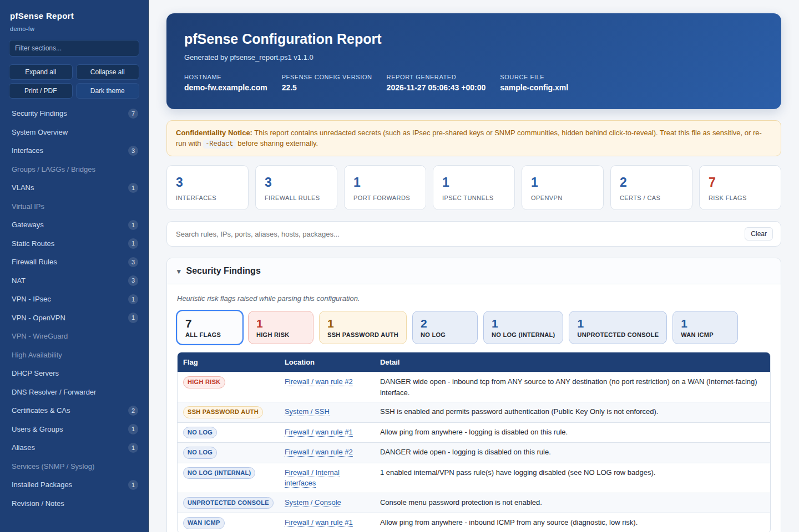
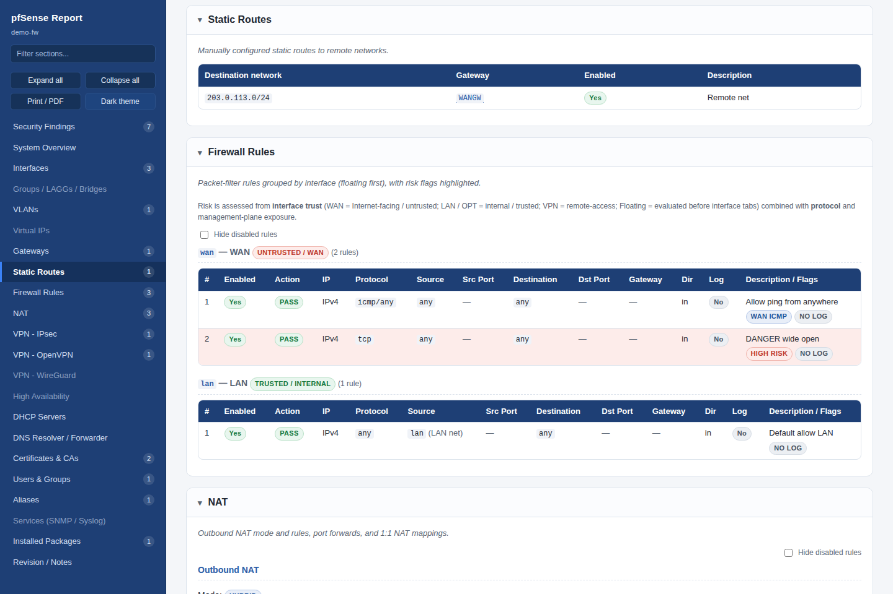

# pf2html — pfSense Config Report

Turn a pfSense `config.xml` backup into a professional, **self-contained HTML report** —
entirely offline. No AI, no external API, no internet connection, and no third-party
PowerShell modules. The output is a single `.html` file you can open in any modern browser
on an air-gapped machine and print to PDF (File → Print → Save as PDF).

[](https://github.com/NeverNathaniel/pf2html/actions/workflows/ci.yml)



## Features

- **Comprehensive pfSense coverage (22 sections):** security findings, system overview,
  interfaces, interface groups / LAGGs / bridges, VLANs, virtual IPs (CARP/IP Alias/Proxy ARP),
  gateways & gateway groups, static routes, firewall rules (floating + per-interface),
  NAT (outbound / port forwards / 1:1 with `nonat`/`nordr`/`nobinat`), IPsec (all Phase 1
  proposals & Phase 2), OpenVPN (servers & clients), WireGuard (tunnels & peers),
  High Availability (CARP / pfsync / XMLRPC sync), DHCPv4 / DHCPv6 & relay, DNS
  resolver/forwarder, certificates / CAs / CRLs, users / groups / LDAP & RADIUS auth servers,
  aliases, system services (SNMP, remote Syslog, Dynamic DNS, schedules), installed packages,
  and revision notes. Absent sections render **"Not configured"** rather than being silently skipped.

- **Context-aware risk model.** Firewall rules are scored by *interface trust*
  (WAN = Internet-facing / untrusted; LAN / OPT = internal / trusted; VPN; Floating) combined
  with *protocol* and management-plane exposure — so a LAN any→any rule isn't a false alarm,
  while the same rule on a WAN or WAN-touching floating rule is:

  | Rule / Condition | Flag |
  |------------------|------|
  | WAN allow to firewall WebGUI / SSH (`wanip` / `(self)`) | 🔴 **WAN MGMT EXPOSED** |
  | WAN (or WAN floating), TCP/UDP or all-protocol, any→any, no port | 🔴 **HIGH RISK** |
  | WAN, any source → a specific port/host | 🟠 **WAN EXPOSED** (published service) |
  | WAN, ICMP from any | 🔵 WAN ICMP (low) |
  | WAN, restricted source (alias / specific IP) | 🔵 WAN (restricted) |
  | LAN / internal, any→any | *not flagged — normal* |

  Each interface group is labeled with its trust level, and every flag is a colored badge
  **with a text label** so it survives black-and-white printing:

  

- **Security Findings summary.** All flags — including **INSECURE WEBGUI** (HTTP),
  **WAN MGMT EXPOSED**, **NAT INLINE PASS**, **SSH PASSWORD AUTH**, **WEAK CRYPTO** /
  **LEGACY CRYPTO** (DES/3DES/MD5/RC4/Blowfish/CAST128/NULL/SHA-1, weak DH/PFS, IKEv1/Aggressive Mode,
  OpenVPN compression), **EXPIRED** / **EXPIRING SOON** / **NOT YET VALID** / **WEAK CERT**
  certificates, **WEAK PASSWORD HASH** (`md5-hash`), **PLAINTEXT LDAP**, **DEFAULT SNMP COMMUNITY**,
  and WAN **NO LOG** indicators (with internal `NO LOG` aggregated cleanly) — are collected into
  one severity-sorted, filterable table at the top of the report with clickable deep links to each row.

- **Certificate intelligence.** Validity dates (`NotBefore` → `NotAfter`), signature algorithm,
  RSA/ECDSA key size, self-signed status, and a single-pass *Used by* column resolving where
  each cert/CA is referenced (WebGUI HTTPS, OpenVPN, IPsec, CRLs, users, syslog, captive portal).
  Private key material is **never** exported.

- **Redaction for safe sharing (`-Redact`).** Replaces PSKs and SNMP communities with
  `[REDACTED]` and masks IPv4, IPv6 (including compressed `::` addresses without touching
  `HH:MM:SS` timestamps), MACs, bare and FQDN hostnames, domains, usernames, email addresses,
  and certificate Subject org/location attributes using **stable tokens** (`IP-001`, `HOST-002`,
  `DOMAIN-001`, `MAC-001`, …) so a sanitized report remains analyzable. Password hashes, private
  keys, WireGuard keys, LDAP/RADIUS secrets, HA sync passwords, DynDNS passwords, and OpenVPN
  TLS static keys are **never** emitted, redacted or not.

- **Interactive, accessible, printable layout.** Fixed sidebar navigation with section filter
  and item counts, global table search, hide-disabled rule toggles, clickable cross-links
  (with alias member hover tooltips), light/dark theme toggle, collapsible WCAG-accessible
  sections, strict Content-Security-Policy, sticky headers, and landscape print CSS — all CSS/JS
  embedded inline, zero external resources.

- **Cross-platform & cross-version PowerShell.** Works on Windows PowerShell 5.1 and
  PowerShell 7+ across Windows, Linux, and macOS — exercised in CI on every push.

## Usage

```powershell
.\pfsense_report.ps1 -ConfigPath "config.xml" -OutputPath "report.html"
```

### Parameters

| Parameter | Description |
|-----------|-------------|
| `-ConfigPath` | **(required)** Path to the pfSense `config.xml` backup. |
| `-OutputPath` | Output `.html` path. Defaults to `<configname>-report.html`; parent folders are created if missing. |
| `-Redact` | Sanitize for sharing: `[REDACTED]` PSKs/SNMP communities, stable-token masking of IPs / MACs / hostnames / domains / users / cert orgs. |
| `-Title "..."` | Custom title shown in the report header. |
| `-LogoPath "logo.png"` | Optional logo embedded inline as base64 (`png`/`jpg`/`gif`/`svg`/`webp`). |
| `-WanInterfaces` | Optional interface keys (e.g. `'opt2','opt3'`) to force as untrusted / WAN. |
| `-InternalInterfaces` | Optional interface keys (e.g. `'opt1'`) to force as trusted / internal. |
| `-ExpiryWarnDays` | Days before certificate expiry to flag `EXPIRING SOON` (default `90`). |
| `-JsonPath` | Optional path to export a structured JSON summary of metadata, counts, and findings (respects `-Redact`). |
| `-PassThru` | Emit a summary object (`counts`, `findings`, `outputPath`, etc.) to the pipeline. |
| `-Quiet` | Suppress status console output (warnings/errors still written). |

### Examples

```powershell
# Internal report
.\pfsense_report.ps1 -ConfigPath ".\config-fw01.xml" -OutputPath ".\fw01.html"

# Sanitized copy to share with a third party
.\pfsense_report.ps1 -ConfigPath ".\config-fw01.xml" -OutputPath ".\fw01-shared.html" -Redact -Title "FW01 (Sanitized)"

# Branded report + structured JSON export for automation
.\pfsense_report.ps1 -ConfigPath ".\config-fw01.xml" -OutputPath ".\fw01.html" -LogoPath ".\logo.png" -JsonPath ".\fw01.json" -Quiet

# Override trust classification on an internal transit interface with a gateway
.\pfsense_report.ps1 -ConfigPath ".\config-fw01.xml" -InternalInterfaces "opt2" -WanInterfaces "opt3"
```

Exit codes: `0` on success; `1` if the config is missing, a directory, malformed XML, contains
a prohibited DTD/XXE declaration, or is not a pfSense backup (clear message on stderr). Configs
from versions outside the validated range get a visible warning banner instead of a hard failure.

## Security notes

- The tool runs **fully offline** and writes local file(s) only. Nothing leaves the machine.
- XML parsing explicitly prohibits DTDs (`DtdProcessing.Prohibit`) and disables external
  entity resolution (`XmlResolver = $null`).
- Generated reports (without `-Redact`) contain real IPs, hostnames, and click-to-reveal
  IPsec PSKs / SNMP communities (flagged with a Confidentiality Notice banner). Treat them
  as sensitive. The included [`.gitignore`](.gitignore) excludes `reports/`, `*.html`, and
  `*config*.xml` so real backups and reports are never committed.
- Private keys, WireGuard keys, TLS static keys, password hashes, HA sync passwords,
  LDAP/RADIUS secrets, and DynDNS passwords are **never** written to the report.
- Note that `-Redact` masks structured identifiers (IPs, MACs, hostnames, domains, emails,
  usernames, cert orgs) and secrets, but free-text firewall/NAT descriptions should still be
  reviewed before external sharing if they contain custom notes or circuit IDs.
- The screenshots above were generated from the **synthetic test fixture**
  ([`tests/fixtures/sample-config.xml`](tests/fixtures/sample-config.xml)) — documentation
  IPs (RFC 5737), fake hashes, and a throwaway self-signed certificate only.

## Requirements

PowerShell 7+ (Windows, Linux, or macOS) **or** Windows PowerShell 5.1. No modules, no internet.

## Repository layout

```
pfsense_report.ps1              The tool — single file, zero dependencies
tests/Invoke-Tests.ps1          Unit, functional & security test suite
tests/fixtures/sample-config.xml Synthetic pfSense config used by tests & screenshots
.github/workflows/ci.yml        Lint (PSScriptAnalyzer) + Windows PS 5.1/7 + Ubuntu PS 7 + JS check
.github/workflows/release.yml   Tag-triggered release: lint, validate, zip, checksum, publish
docs/                           README screenshots
```

## Development

Run the test suite locally — it exercises unit tests (redaction, crypto, exposure), full
report rendering, JSON export, secret-leakage checks, XXE/XPath/XSS defenses, and error codes:

```powershell
pwsh ./tests/Invoke-Tests.ps1               # PowerShell 7 (Windows / Linux / macOS)
powershell -File ./tests/Invoke-Tests.ps1   # Windows PowerShell 5.1
```

CI ([`ci.yml`](.github/workflows/ci.yml)) runs PSScriptAnalyzer (zero errors/warnings), the
test suite on Windows PowerShell 5.1, Windows PowerShell 7, and Ubuntu PowerShell 7, plus
encoding and embedded JavaScript syntax (`node --check`) verification on every push and PR.

## Releases

Releases are produced automatically by pushing a semver tag:

```bash
git tag v1.1.0
git push origin v1.1.0
```

The [release workflow](.github/workflows/release.yml) runs PSScriptAnalyzer and tests on both
PowerShell engines, packages `pfsense_report.ps1` (plus README / LICENSE / CHANGELOG) into a
versioned `.zip` with lowercase LF SHA-256 checksums, and publishes a GitHub Release with
auto-generated notes. See [CHANGELOG.md](CHANGELOG.md) for version history.

## License

[MIT](LICENSE)
